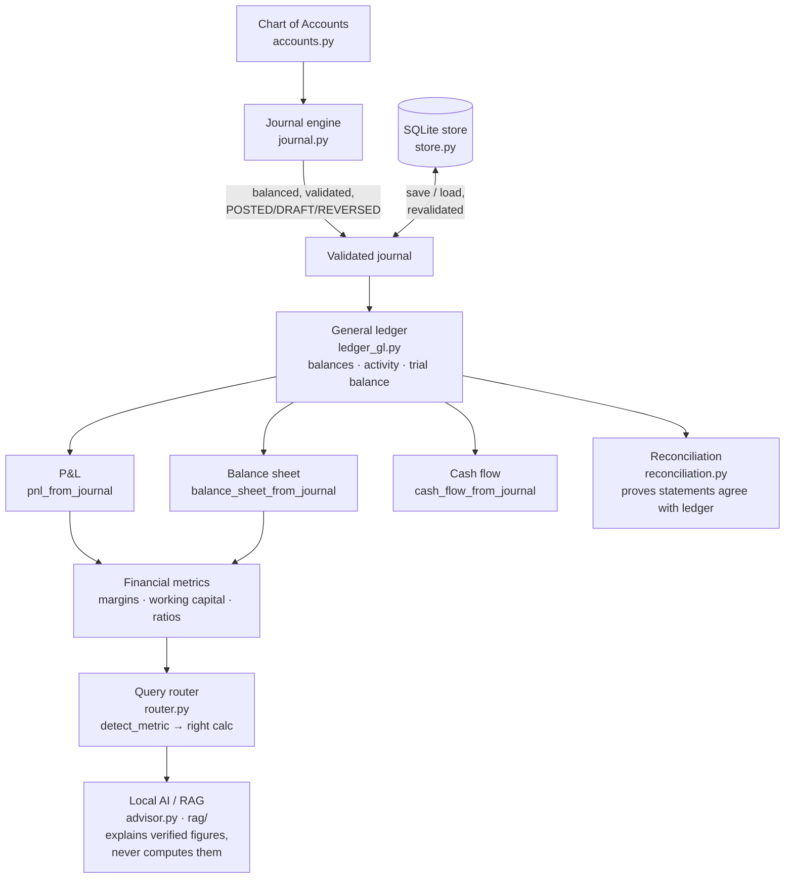

# Unified Accounting Architecture (v1.5.x)

The journal is the single source of truth. Every authoritative statement is
derived from posted journal entries via the general ledger — there is no
separately-entered P&L or balance-sheet dataset.



Plain-text fallback:

```
Chart of Accounts -> Journal -> (SQLite store) -> General ledger
   -> P&L / Balance sheet / Cash flow -> Metrics -> Router -> Local AI
General ledger -> Reconciliation (invariant checks)
```

## Data flow guarantees

- **Postings** carry a signed `Decimal` amount: debit +, credit −. An entry is
  posted only if its postings sum to zero (double-entry).
- **General ledger** (`ledger_gl.py`) nets postings per account. Sign convention
  (stated once, used everywhere): `account_balance` returns
  *normal-balance-positive* (a debit-normal asset with a net debit is positive);
  `trial_balance` reports each account on its natural debit/credit side.
- **Statements** read GL balances. `pnl_from_journal` reuses the v1.4.0
  `calculate_pnl` formula; `balance_sheet_from_journal` builds the v1.4.0
  `BalanceSheet`. Both are driven by the explicit account→statement-category
  mapping in `accounts.py`, never by account-name guessing.

## Retained earnings (important accounting assumption)

A journal that has not been period-closed still holds revenue/expense balances in
income accounts. `balance_sheet_from_journal` folds **net income to date**
(revenue − expenses through `as_of`) into equity as retained earnings, so the
accounting identity `Assets = Liabilities + Equity` holds without requiring an
explicit closing entry. This is the standard close-to-retained-earnings step,
done on the fly. It is documented, not silent. Limitation: there is no separate
"retained earnings b/f" vs "current-year profit" split, and no multi-period
closing — all profit to `as_of` sits in one derived figure.

## What the LLM may and may not do

The router computes every number with deterministic code. The RAG layer only
retrieves reference knowledge and explains verified figures. No LLM performs
authoritative arithmetic (prompt rule 5).
